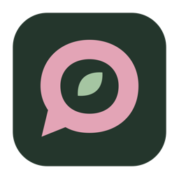
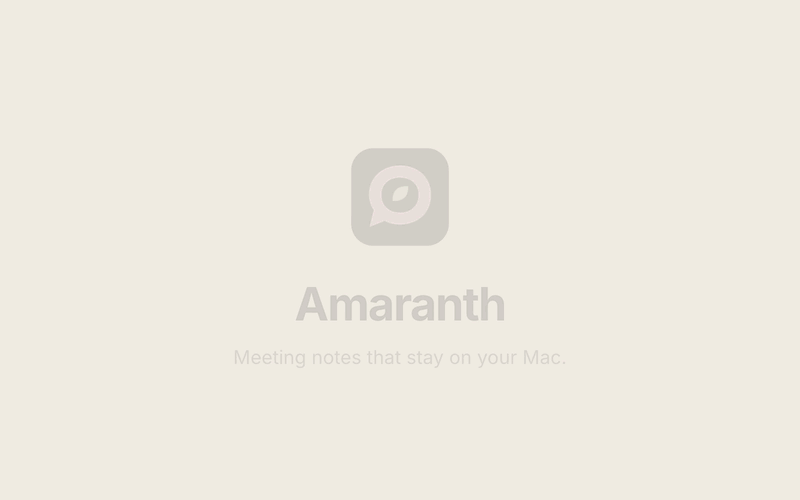
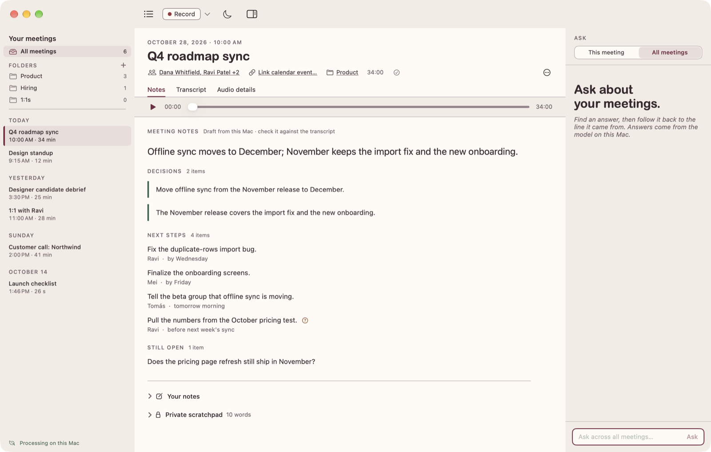
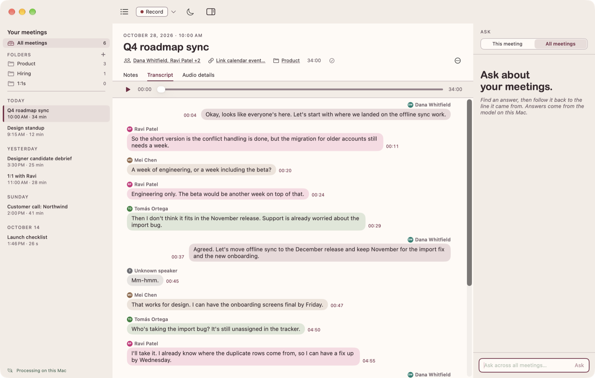
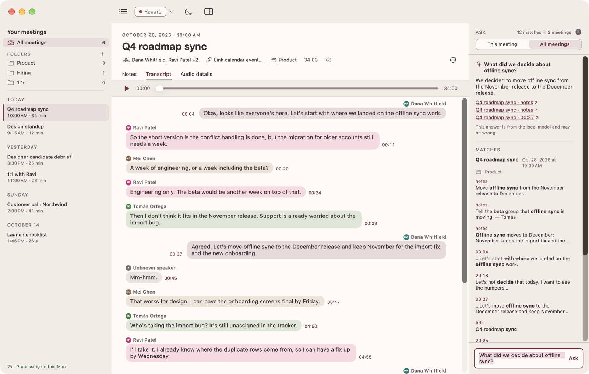

<p align="center">
  
</p>

<h1 align="center">Amaranth</h1>

<p align="center">
  Meeting notes that stay on your Mac.
</p>

<p align="center">
  <a href="docs/readme/demo.mp4">
    
  </a>
</p>

Amaranth records your meetings on your Mac, capturing both your microphone and the call audio. When the meeting
ends, it writes a transcript that shows who said what, plus short notes: what you decided, what happens next, and
what's still open. You can then ask questions across all your meetings.

It all happens on your Mac. Nothing is uploaded, and there's no account.

## What it does

- **Records any call.** Zoom, Meet, Teams, Slack or anything else that plays sound. Amaranth records your mic and
  the call audio separately, so it can tell you apart from the other people on the call.
- **Shows live text** a few seconds behind the conversation, so you can see it's working. You can also jot down
  private notes in a scratchpad while you talk.
- **Writes a transcript with speakers** after you stop. Rename "Speaker 2" to a real name once and it's fixed
  everywhere. Click any line to play the audio from that point.
- **Drafts notes you can check.** Every decision and next step links back to the lines it came from. Anything the
  transcript only partly supports gets a **?** marker, so you know what to double-check.
- **Answers questions** like "what did we decide about the launch?" across one meeting, one folder, or all of them,
  with links to the moments it's quoting.
- **Organizes and exports.** Sort meetings into folders, add attendees, link a calendar event, and export to
  Markdown, plain text or JSON (or get the original audio back).

<p align="center">
  <picture>
    <source media="(prefers-color-scheme: dark)" srcset="docs/readme/notes-dark.png">
    
  </picture>
</p>

<table>
  <tr>
    <td width="50%">
      <picture>
        <source media="(prefers-color-scheme: dark)" srcset="docs/readme/transcript-dark.png">
        
      </picture>
      <p align="center"><sub>The transcript, split by speaker</sub></p>
    </td>
    <td width="50%">
      <picture>
        <source media="(prefers-color-scheme: dark)" srcset="docs/readme/ask-dark.png">
        
      </picture>
      <p align="center"><sub>Ask a question and jump to the source</sub></p>
    </td>
  </tr>
</table>

<sub>Screenshots use a made-up sample meeting.</sub>

## What you need

- A Mac with Apple silicon (M2 or newer is recommended) running **macOS 26.5.2 or later**. Intel Macs aren't
  supported.
- To build it: [Xcode](https://apps.apple.com/app/xcode/id497799835) 27 or later and [Homebrew](https://brew.sh)
- About **3 GB** of free space for the speech and notes models, which download once
- Roughly **2 GB per hour** of recording, since audio is saved in full quality

## Getting started

Amaranth isn't on the App Store yet, so for now you build it yourself. It takes a few minutes.

1. **Install the tools.** With Xcode and Homebrew installed, add [XcodeGen](https://github.com/yonaskolb/XcodeGen),
   which sets up the Xcode project:

   ```sh
   brew install xcodegen
   ```

2. **Get the code:**

   ```sh
   git clone <this repository's URL> amaranth
   cd amaranth
   ```

3. **Optional: sign with your own Apple developer team.** You can skip this. Without it, macOS asks for microphone
   permission again every time you rebuild. A free personal team (just your Apple ID in Xcode) is enough. Copy the
   example file and put your 10-character Team ID in it. You'll find the ID in Xcode under **Settings → Accounts**.

   ```sh
   cp Config/Signing.local.xcconfig.example Config/Signing.local.xcconfig
   # then open the new file and set DEVELOPMENT_TEAM to your Team ID
   ```

4. **Build and install:**

   ```sh
   scripts/install-local.sh
   ```

   This builds the app, puts it in `/Applications`, and opens it. The first build takes a few minutes. Run the same
   command again later to update. It won't replace the app while you're recording.

## Your first meeting

1. **Download the models.** The first time you open Amaranth, it offers to download the speech and notes models
   (about 3 GB). Say yes. If you skip it, recording still works, and the transcript and notes appear once the models
   are in (**Settings → Models**).
2. **Tell the other people on the call you're recording.**
3. **Click Record** (⇧⌘R) to start right away. To name the meeting, pick a microphone or choose a folder first,
   click the ▾ next to it instead, then **Start recording**.
4. **Allow access when macOS asks.** Amaranth needs the **microphone** and **system audio recording**. If you click
   Don't Allow by accident, it shows a button that opens the right page in Privacy settings.
5. **Have your meeting.** A red icon in the menu bar shows how long you've been recording. You can close the window
   and recording carries on.
6. **Click Stop** (⇧⌘S). Amaranth writes up the transcript and notes in the background, and the meeting shows how
   far along it is. For a one-hour meeting that's about ten minutes on an M2 Max, and longer on slower Macs.

### After the meeting

- **Notes** (⌘1) show the summary, decisions, next steps and open questions. Press ⌘D to see where each item came
  from, or right-click one and choose **Show in Transcript**.
- **Transcript** (⌘2): click a time to play from there, and press Space to pause. Right-click a line to fix a word
  or change who said it. If Amaranth couldn't tell who was speaking, the line says "Unknown speaker". Click
  **Identify** to name them.
- If you fix speakers or wording, the notes say they're out of date. Click **Regenerate** to refresh them. Your own
  notes are never changed.
- **Audio details** (⌘3) shows what was recorded from each source, and any gaps.
- **Ask** (⌘K) opens the question box on the right. Type a question in plain words, then click a result to jump to
  that moment.

### Handy shortcuts

| Action | Shortcut |
|---|---|
| Record / Pause / Stop | ⇧⌘R / ⇧⌘P / ⇧⌘S |
| Notes / Transcript / Audio details | ⌘1 / ⌘2 / ⌘3 |
| Show where notes came from | ⌘D |
| Ask a question | ⌘K |
| Export as Markdown | ⌘E |
| New folder | ⇧⌘N |
| Switch light / dark | ⇧⌘L |

## Your data

Everything lives in `~/Library/Application Support/Amaranth/`, readable only by your user account.

- **Delete Audio Only** removes the recording but keeps the transcript and notes.
- **Delete Meeting** removes everything for that meeting, and it no longer shows up in Ask.
- If the app or your Mac crashes mid-meeting, Amaranth recovers the recording the next time you open it. You might
  lose the last second or two.

## Good to know

- Transcripts work best in English.
- When people talk over each other, Amaranth sometimes gets the speaker wrong, so expect to fix a few names.
- The notes are written by a small AI model on your Mac, so they can be wrong. Anything important is worth checking
  against the transcript lines they link to.
- Found a bug or have an idea? Please open an issue.

## For developers

- `scripts/check.sh` runs the tests and builds the app.
- `scripts/build-release.sh` makes a DMG in `dist/` you can share. It isn't notarized, so the first time someone
  opens it they need to right-click the app and choose **Open**.
- The design and plan live in [`docs/`](docs/): start with [`docs/development-plan.txt`](docs/development-plan.txt).
  Decision records are in [`docs/decisions/`](docs/decisions/).
- The models download from Hugging Face and are checked against the hashes in [`Models/Packs/`](Models/Packs/):
  - [Parakeet TDT 0.6B v3](https://huggingface.co/nvidia/parakeet-tdt-0.6b-v3) for transcription
  - [pyannote](https://github.com/pyannote/pyannote-audio) for telling speakers apart
  - [Silero VAD](https://github.com/snakers4/silero-vad) for finding speech
  - [Qwen3 4B Instruct](https://huggingface.co/Qwen/Qwen3-4B-Instruct-2507) for notes and answers
